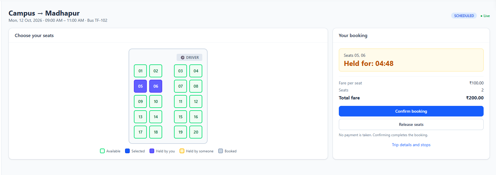
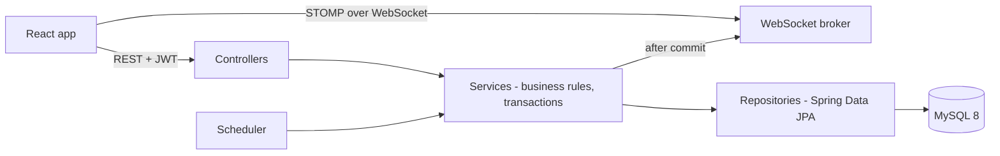
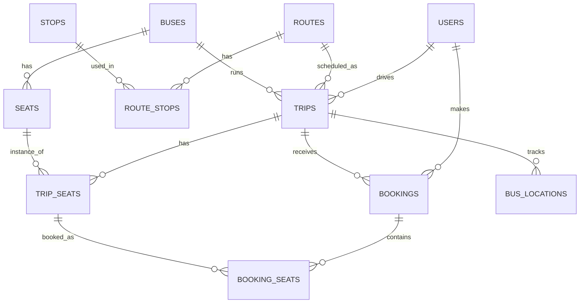
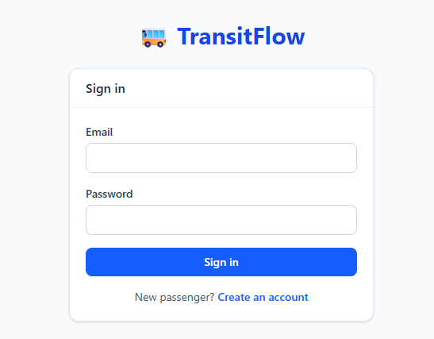
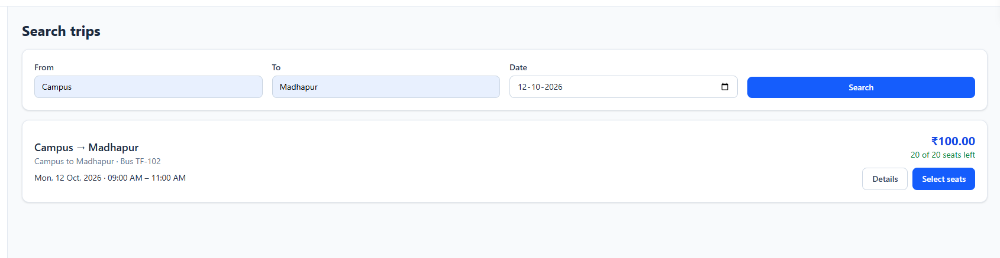
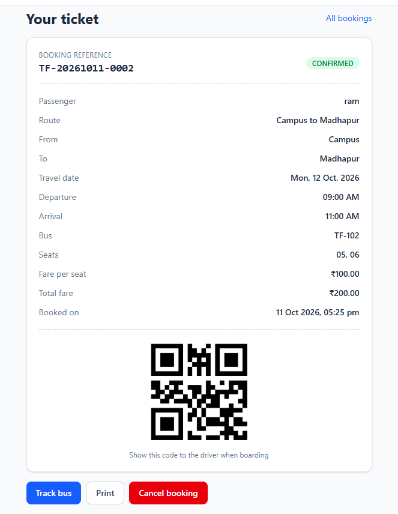
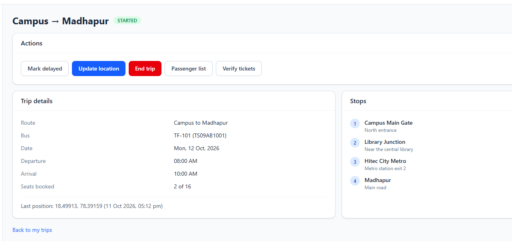
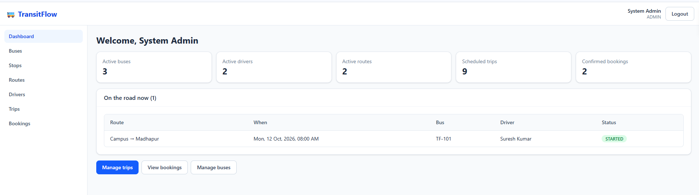

# TransitFlow – Bus Transportation Management System

A full-stack bus shuttle management and seat reservation system for colleges, companies, campuses and private shuttle services. Admins schedule buses, routes and trips; passengers search, pick seats on a live seat map and get QR tickets; drivers run the trip, verify tickets and share the bus location in real time.

Built to demonstrate **Java 21, Spring Boot 3, Spring Security + JWT, JPA/Hibernate, MySQL, transactions and concurrency control, REST and WebSocket (STOMP), and React**.



## Problem Statement

Shuttle operators commonly manage seats by phone or spreadsheet. That causes double-booked seats, no visibility into where the bus is, and no reliable way to check tickets at boarding.

## Objective

Provide one system where seat availability is always correct, even when many passengers book at the same moment, and where everyone sees changes instantly.

## Features

**Passenger**
- Register, log in, search trips by source, destination and date
- Visual seat map with live updates (available, held, booked)
- Hold seats for 5 minutes with a countdown, then confirm the booking
- Booking reference (`TF-20261012-0001`), ticket with QR code, booking history, cancellation (up to 2 hours before departure)
- Live bus tracking on a map

**Driver**
- Assigned trips with passenger counts
- Start, delay, resume and end a trip (a validated state machine)
- Boarding list and ticket verification (VALID / INVALID)
- Location updates, with a movement simulator (no GPS hardware needed)

**Admin**
- Buses, seat layout generator, stops, routes with ordered stops, drivers, trips
- Overlap prevention for buses and drivers
- Booking search and details, trips currently on the road

## User Roles

| Role | Can do |
|---|---|
| ADMIN | Manage buses, seats, routes, stops, drivers, trips and fares; view bookings and active trips |
| DRIVER | View assigned trips; start, delay, resume and end them; passenger list; verify tickets; send location |
| PASSENGER | Search, hold seats, book, cancel, view tickets, track the bus |

Roles are enforced on the **server**. The React route guards only improve the experience.

## Technology Stack

| Layer | Technology |
|---|---|
| Backend | Java 21, Spring Boot 3.5, Spring Web, Spring Data JPA (Hibernate), Spring Security, JWT (jjwt), Bean Validation, Spring WebSocket (STOMP), Spring Scheduler, ZXing (QR), springdoc OpenAPI, Maven |
| Database | MySQL 8 |
| Frontend | React, Vite, JavaScript, React Router, Axios, Tailwind CSS, @stomp/stompjs |
| Tests | JUnit 5, Mockito, MockMvc |

## System Architecture



Layers: `controller → service → repository → database`. Controllers hold no business logic, and entities are never returned from the API (DTOs only).

## Database Schema



Key design point: a **physical seat** belongs to a bus (`seats`). Its **availability** belongs to a trip (`trip_seats`: `AVAILABLE`, `HELD`, `BOOKED`, with `hold_expiry`, `held_by` and a `@Version` column). `booking_counters` holds one row per day for reference numbers.

## Authentication Flow

1. `POST /api/auth/login` verifies the BCrypt password and returns a signed JWT (HS256, 24 hours).
2. The React app stores the token and sends `Authorization: Bearer <token>` on every request (Axios interceptor).
3. `JwtAuthenticationFilter` validates the token and loads the user **from the database on every request**, so deactivating a user takes effect immediately.
4. URL rules in `SecurityConfig` enforce roles. A missing or invalid token gives `401`, and the wrong role gives `403`, both as JSON.
5. Registration always creates a `PASSENGER`. The request has no role field. Drivers are created only by admins.

## Booking Flow

```
Search trip → Select trip → View seat map → Select seats → Hold (5 min, countdown)
→ Confirm → Booking created (TF-yyyyMMdd-0001) → QR ticket → History
```

There is no payment gateway. Confirming completes the booking.

## Seat-Hold Flow

1. `POST /api/bookings/hold` locks the requested seat rows, checks all of them, then marks them `HELD` with an expiry. A hold is **all-or-nothing**.
2. `POST /api/bookings/confirm` re-checks on the server that every seat is held by the caller and **not expired**, then marks them `BOOKED`.
3. A scheduler releases expired holds every 30 seconds. Correctness does **not** depend on it: every read and write also treats an expired hold as available.
4. The browser countdown is cosmetic. The server returns `secondsRemaining`, so clock differences don't matter.

## Double-Booking Prevention

Two passengers can never get the same seat:

| Layer | What it does |
|---|---|
| `SELECT ... FOR UPDATE` on the requested `trip_seats` rows (`PESSIMISTIC_WRITE`) | The second request waits, then sees the seat as held and fails with `Seat 10 is no longer available` |
| `@Version` optimistic locking | Backstop for any write that skips the lock. The loser gets `ObjectOptimisticLockingFailureException`, mapped to HTTP 409. |
| All-or-nothing validation | No partial holds |
| Server-side expiry and ownership checks | A passenger can't confirm someone else's seat or an expired hold |
| Lock order trip → booking → seats → counter | Avoids deadlocks |
| `FOR SHARE` lock on the trip row | An admin cancelling a trip can't slip between a booking's check and its write |

`DoubleBookingConcurrencyTest` fires two simultaneous holds for the same seat and asserts that exactly one succeeds.

## WebSocket Flow

STOMP over WebSocket at `ws://localhost:8080/ws`.

| Topic | Payload | Who may subscribe |
|---|---|---|
| `/topic/trips/{id}/seats` | Seat changes (no user identity) | Passengers, admins |
| `/topic/trips/{id}/status` | Trip status changes | Passengers, admins, the assigned driver |
| `/topic/trips/{id}/location` | Bus position | Passengers with a **confirmed booking** on the trip, the assigned driver, admins |

- The JWT is sent in the STOMP `CONNECT` frame and validated by a channel interceptor. Every `SUBSCRIBE` is authorized. Clients cannot `SEND`.
- Services publish events inside their transaction. A `@TransactionalEventListener(AFTER_COMMIT)` pushes them, so a rolled-back change never reaches anyone.
- REST is the source of truth. After connecting or reconnecting, the client refetches.

## API Documentation

Interactive docs: **http://localhost:8080/swagger-ui.html** (disabled in the `prod` profile). Log in through `/api/auth/login`, then use **Authorize** and paste the token.

| Area | Endpoints |
|---|---|
| Auth | `POST /api/auth/register`, `POST /api/auth/login`, `GET /api/auth/me` |
| Trips (passenger, admin) | `GET /api/trips/search`, `GET /api/trips/{id}`, `GET /api/trips/{id}/seats`, `GET /api/trips/{id}/location` |
| Bookings (passenger) | `POST /api/bookings/hold`, `DELETE /api/bookings/hold/{tripId}`, `POST /api/bookings/confirm`, `GET /api/bookings/my`, `GET /api/bookings/{id}`, `PUT /api/bookings/{id}/cancel` |
| Driver | `GET /api/driver/trips`, `GET /api/driver/trips/{id}`, `PUT /api/driver/trips/{id}/start`, `/end`, `/status`, `/location`, `GET /api/driver/trips/{id}/passengers`, `POST /api/driver/tickets/verify` |
| Admin | `/api/admin/buses` (+ `/{id}/seats`, `/{id}/seats/generate`), `/api/admin/stops`, `/api/admin/routes`, `/api/admin/drivers`, `/api/admin/trips` (+ `/active`), `/api/admin/bookings` (+ `/{id}`) |

Every response uses one shape:

```json
{ "success": false, "message": "Seat 12 is no longer available", "timestamp": "..." }
```

## Project Structure

```
transitflow/
├── transitflow-backend/
│   └── src/main/java/com/naveen/transitflow/
│       ├── config/       security, WebSocket, scheduling, OpenAPI, seeders
│       ├── controller/   thin REST controllers
│       ├── dto/          request and response records
│       ├── entity/       JPA entities and enums
│       ├── exception/    custom exceptions + @RestControllerAdvice
│       ├── repository/   Spring Data JPA repositories
│       ├── scheduler/    hold-expiry job
│       ├── security/     JWT service, filter, entry points
│       ├── service/      interfaces + impl/ (business rules)
│       ├── util/         QR code generator
│       └── websocket/    topics, publisher, after-commit listener, STOMP security
└── transitflow-frontend/
    └── src/
        ├── api/          Axios instance, session storage
        ├── components/   Button, Input, Modal, Table, SeatMap, TripCard, ...
        ├── context/      AuthContext
        ├── hooks/        useAuth, useTripSocket, useApiList
        ├── pages/        passenger, driver and admin pages
        └── utils/        formatting helpers
```

## Requirements

Java 21, Maven 3.9+, MySQL 8, Node 20.19+ (or 22.12+).

## MySQL Setup

```sql
CREATE DATABASE transitflow CHARACTER SET utf8mb4 COLLATE utf8mb4_unicode_ci;
CREATE USER 'transitflow_user'@'localhost' IDENTIFIED BY 'your-password';
GRANT ALL PRIVILEGES ON transitflow.* TO 'transitflow_user'@'localhost';

-- only needed to run the integration tests
CREATE DATABASE transitflow_test CHARACTER SET utf8mb4 COLLATE utf8mb4_unicode_ci;
GRANT ALL PRIVILEGES ON transitflow_test.* TO 'transitflow_user'@'localhost';
FLUSH PRIVILEGES;
```

## Environment Configuration

Backend (environment variables; nothing secret lives in the repository):

| Variable | Required | Default | Purpose |
|---|---|---|---|
| `DB_PASSWORD` | yes | – | Database password |
| `JWT_SECRET` | yes | – | At least 32 characters |
| `ADMIN_PASSWORD` | yes | – | Password of the seeded admin |
| `DB_URL` | no | local MySQL | JDBC URL |
| `DB_USERNAME` | no | `transitflow_user` | Database user |
| `ADMIN_EMAIL` | no | `admin@transitflow.com` | Seeded admin login |
| `CORS_ALLOWED_ORIGINS` | no | `http://localhost:5173` | Comma-separated. Used for REST **and** WebSocket. |
| `HOLD_MINUTES` | no | `5` | Seat hold length |
| `CANCELLATION_CUTOFF_HOURS` | no | `2` | Cancellation cutoff |
| `DRIVER_START_WINDOW_MINUTES` | no | `60` | How early a driver can start a trip |
| `DEMO_DATA` | no | `false` | Seed sample data into an empty database |
| `SPRING_PROFILES_ACTIVE` | no | – | `dev` (SQL logging) or `prod` (`ddl-auto=validate`, no Swagger, no demo data) |

Frontend: copy `transitflow-frontend/.env.example` to `.env` (`VITE_API_URL`, `VITE_WS_URL`).

## How to Run the Backend

```bash
cd transitflow-backend
# Windows cmd:        set DB_PASSWORD=...  &  set JWT_SECRET=...  &  set ADMIN_PASSWORD=...
# PowerShell:         $env:DB_PASSWORD="..."; $env:JWT_SECRET="..."; $env:ADMIN_PASSWORD="..."
# macOS / Linux:      export DB_PASSWORD=... JWT_SECRET=... ADMIN_PASSWORD=...
mvn spring-boot:run
```

Add `DEMO_DATA=true` on the first start to get sample buses, routes, drivers, trips and passengers.

Run the tests (needs the `transitflow_test` database): `mvn test`

## How to Run the Frontend

```bash
cd transitflow-frontend
npm install
npm run dev          # http://localhost:5173
```

Production build: `npm run build`, then `npm run preview`.

## Demo Accounts

| Role | Email | Password |
|---|---|---|
| Admin | `admin@transitflow.com` | your `ADMIN_PASSWORD` |
| Driver | `suresh@transitflow.com`, `ramesh@transitflow.com` | `Demo@12345` |
| Passenger | `ravi@example.com`, `anil@example.com` | `Demo@12345` |

(Drivers and passengers exist only when `DEMO_DATA=true` was used on an empty database.)

## Screenshots

| | |
|---|---|
|  |  |
|  |  |
|  |  |


## Known Limitations

- Schema is created by Hibernate. A migration tool (Flyway) is the right production choice.
- The JWT is kept in `localStorage`. An httpOnly cookie would resist XSS better.
- The WebSocket broker is in memory, so it supports one server instance. Scaling out needs an external broker such as RabbitMQ.
- Missed WebSocket messages aren't replayed. Clients refetch on reconnect.
- Stops have no coordinates, so the movement simulation walks between two points and not along the route.
- A ticket can be verified more than once (no "checked in" flag).
- No payment gateway, email or SMS.

## Future Enhancements

Payment gateway with refunds; Flyway migrations; refresh tokens and httpOnly cookies; RabbitMQ broker; stop coordinates and real GPS; signed (HMAC) QR codes and a check-in flag; pagination and filters; email and SMS tickets; rate limiting; CI pipeline; admin analytics.